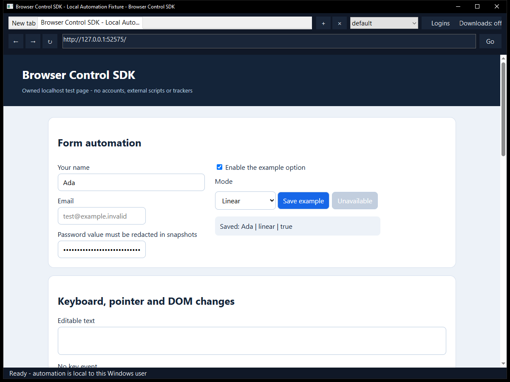

# Browser Control SDK - Windows Browser for AI and Automation

A native **Windows Chromium browser** built to be controlled through a small SDK.
Open tabs, work with separate profiles, read a page as structured elements, click
and type, change the viewport, and capture the visible page, a region or the full
document. The browser window stays available for normal manual interaction.

**[Download](https://github.com/TitanCSA/Browser-Control-SDK/releases/latest)** |
[SDK reference](SDK/README.md) | [AI / MCP](MCP/README.md) |
[API methods](Protocol/API.md) | [Security](docs/SECURITY.md) |
[Validation](docs/VALIDATION.md)



## Start

1. Extract the complete Windows x64 release ZIP and run **BrowserControl.exe**.
2. Open a page with the address bar, create tabs and choose a profile normally.
3. Connect a script with `Browser.connect()`, or let `Browser.launch()` start a
   dedicated instance automatically.

The browser uses the **Microsoft Edge WebView2 Evergreen Runtime**. Many Windows
10/11 PCs already have it; if it is missing, the app offers Microsoft's official
download page. The browser does not silently install a runtime. No administrator
rights or input driver are required.

### A complete small Python example

Python 3.10+; the SDK itself uses only Python's standard library:

```powershell
python -m pip install ./SDK/Python
python Tests/fixture_server.py --port 8765
```

In another terminal, run:

```python
from browser_control import Browser

browser = Browser.connect()      # Connect to the browser opened in step 1.
tab = browser.new_tab()
tab.goto("http://127.0.0.1:8765")
tab.fill("Ada", selector="#name")
tab.click(selector="#save")
print(tab.snapshot()["text"])
tab.screenshot(path="page.png", full_page=True)
```

This example stays on the supplied local demonstration page. Use selectors you
know, or take a snapshot and click an element's returned `ref`. The SDK preserves
request IDs, infers framing lengths, waits for operations and raises detailed
English errors. Call `browser.shutdown()` to close that instance explicitly.
To start the browser from code instead, use `Browser.launch()` before opening it
manually, or supply a separate private `profile_root` for another instance.

## What you can control

| Area | SDK controls |
| --- | --- |
| Tabs | Create, select, inspect and close; navigation, back, forward, reload and stop |
| Page understanding | Visible text, semantic roles/names, fields, state and CSS bounds; snapshot references |
| Interaction | Click by ref, selector or position; fill, type, key down/up, shortcuts, mouse movement/buttons and wheel |
| Waiting | Wait for visible, hidden or attached targets; navigation load or DOM-ready waits and explicit timeouts |
| Images | Viewport, full-page and selected-region PNG/JPEG screenshots, live frame iterators and coordinate metadata |
| Layout | Window size/state, emulated viewport, device scale and zoom |
| Profiles | Separate persistent profiles and private contexts, with distinct cookies/session state |
| Data | Explicit cookie list/set/clear and current-origin local/session storage |
| Settings | JavaScript, devtools, context menus, status bar, zoom and user agent |
| Advanced | Page JavaScript evaluation and renderer-supported Chromium DevTools Protocol commands |
| Diagnostics | Bounded navigation/download events, operation errors, capability discovery and download controls |

The SDKs share one protocol:

| Language / client | Files |
| --- | --- |
| Python | [browser_control.py](SDK/Python/browser_control.py), installable local package |
| JavaScript | [browser-control.mjs](SDK/JavaScript/browser-control.mjs), Node 18+, no npm runtime dependency |
| C++17 | [BrowserControl.h](SDK/Cpp/BrowserControl.h) and [BrowserControl.cpp](SDK/Cpp/BrowserControl.cpp), with the supplied JSON header |
| AI clients | [Local stdio MCP server](MCP/README.md), including screenshot image responses |
| Other languages | [Length-prefixed UTF-8 JSON protocol](Protocol/API.md) over a private Windows named pipe |

Typed helpers cover common actions. `browser.call(method, params)` and the C++
`Call()` equivalent expose the rest without adding another integration layer.
`browser.capabilities()` reports the implemented methods and engine boundaries.
See [Examples](Examples) for independent, small scripts.

## Faster AI workflows

**`observe()`** returns a compact page view with labelled controls. **`act()`**
executes a finite plan in one SDK request and returns the resulting observation.
Targets accept exact accessible names and roles, selectors or snapshot refs.

```python
page = tab.observe(max_elements=40, max_text=3000)
result = tab.act([
    {"action": "fill", "name": "Your name", "role": "textbox", "text": "Ada"},
    {"action": "click", "name": "Save example", "role": "button"},
], expected_generation=page["generation"])
print(result["observation"])
```

Run this against the supplied local fixture. Plans contain at most 20 actions,
stop on the first failure and report completed steps without replaying mutations.
Optional generation/URL guards reject outdated plans. MCP **`browser_observe`**
and **`browser_act`** can use the active tab without a tab-list call.
See the [AI examples](Examples/README.md).

## Sign in once, keep the session

A human can sign in normally in a persistent profile. Its cookies and site
storage remain with that profile when the website permits it.

For an optional password fallback, enter the credentials on the site's sign-in
form and choose **Logins → Save current login**. Confirm the exact site and
profile. Saved logins are encrypted with **Windows current-user DPAPI**. Use
**Fill saved login** later, or explicitly enable automatic filling for that login.
The native menu lets you choose between multiple saved accounts.

```python
status = tab.login()                         # Status only.
if status["available"]:
    result = tab.login("fill", submit=True)  # One explicit form submission.
```

Select `credential_id=` when several accounts match. Filling requires the saved
**exact origin and profile**. Automatic filling never submits forms; `submit=True`
is an explicit SDK choice and does not certify successful sign-in. Login results
and observations omit passwords. Saving/filling requires HTTPS, with loopback HTTP
allowed for the fictitious tests. Private profiles cannot use the vault.

Sites can expire cookies, require MFA/passkeys or reject embedded browsers, so
some connections still need human input. [Sessions and saved logins](docs/SESSIONS.md).

## Use with an AI

Connect the supplied [MCP server](MCP/README.md) to a client that supports local
stdio tools. It can attach to an open instance or launch one on its first tool
call. A typical task is: read the snapshot, select a visible target, perform the
requested action, then inspect the updated state or screenshot.

Snapshots exclude password values and hidden input fields by default. Page text
is **untrusted website content**, not an instruction source. Snapshot refs belong
to one document/snapshot generation; take a fresh snapshot after navigation or a
stale-ref error. Screenshots include the web page, rather than the user's entire
desktop.

## Sessions and operation results

Each browser instance publishes a private local endpoint for its current Windows
user. The SDK discovers it automatically, or you select it explicitly. There is
no network control listener. Profiles belong to this app and remain independent
from existing Chrome/Edge profiles. Authenticate normally inside a chosen browser
profile when a site requires it; persistent profiles retain their own data.
One instance owns a data folder at a time. Connect to that instance, or select a
different private `profile_root` when launching another browser concurrently.

Cookie access and page evaluation are powerful explicit operations. Use private
profile folders and protect endpoint files, screenshots and exported data. An
operation whose result is unknown may already have executed: inspect state before
retrying a click, form submission or other side effect. [Security and storage](docs/SECURITY.md).

The host limits tabs, profiles, request sizes, screenshots and event buffers.
Unsupported engine operations return errors. This is a WebView2-based browser,
not the entire Microsoft Edge product: Edge sync/password-manager UI, the Chrome
extension store, unrestricted browser-process CDP and universal website/login
compatibility are outside this version. Snapshot helpers currently cover the
main frame; use renderer APIs explicitly where supported for advanced frame work.
Website access controls, MFA and CAPTCHA still require the site's normal flow.

## Build

Windows x64, Visual Studio 2022 C++ tools, a Windows SDK, CMake 3.24+ and Python
3.10+ for client validation:

```powershell
.\Build.ps1 -Test
```

The build downloads a pinned, SHA-256-verified **Microsoft.Web.WebView2 SDK** from
NuGet on its first run. The runtime is a separate Microsoft component. Subsequent
builds can reuse `obj/Dependencies`. Output: `obj/Build/bin/Release/BrowserControl.exe`.
Building and offline checks do not open websites or install anything.

```text
App/          Native browser, profile management and private IPC
SDK/          Python, JavaScript and C++ clients
MCP/          AI client bridge over stdio
Examples/     Small independent automation examples
Protocol/     Public method and transport reference
Tests/        Owned local fixture, integration and offline checks
ThirdParty/   Pinned dependency records and licenses
docs/         Security, validation and interface images
```

Project source is [MIT licensed](LICENSE); third-party components retain their
own terms. Microsoft supplies and services the WebView2 Runtime. This app is not
endorsed by Microsoft. Use it only with systems and accounts you are authorized
to operate and follow the rules of the services you access. Supplied as-is; see
the license for warranty terms. Contact: **Discord `titancsa`**.
